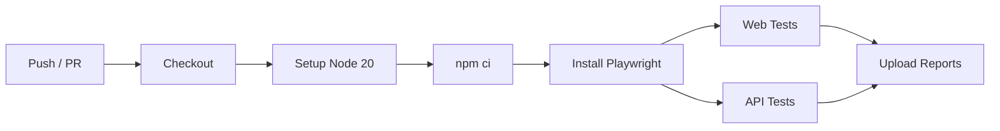

# CI/CD — GitHub Actions

Pipeline de integração contínua que executa os testes automaticamente a cada
`push` ou `pull request` na branch `main`.

## Pipeline

Arquivo: [`ci-cd/.github/workflows/ci.yml`](.github/workflows/ci.yml)



## Etapas

1. **Checkout** do código.
2. **Setup Node.js 20** com cache de dependências.
3. **Instalação** das dependências (`npm ci`).
4. **Instalação dos browsers** do Playwright.
5. **Execução dos testes Web e API**.
6. **Upload dos relatórios** como artefatos (sempre, mesmo em falha).

## Como habilitar no GitHub

O workflow está em `ci-cd/.github/workflows/`. Para que o GitHub Actions o reconheça,
os pipelines precisam estar em `.github/workflows/` na raiz do repositório.

**Opção A (recomendada):** mova/sincronize o arquivo para a raiz:

```bash
mkdir -p .github/workflows
cp ci-cd/.github/workflows/ci.yml .github/workflows/ci.yml
```

**Opção B:** mantenha a versão canônica em `ci-cd/` e use um passo de sync, ou
configure o repositório para usar essa pasta como raiz de workflows.

## Extensões futuras

- Job de **testes de performance** (k6) em horário agendado (`schedule`).
- Publicação de relatório HTML no **GitHub Pages**.
- Matrix de testes por múltiplos browsers (chromium, firefox, webkit).
